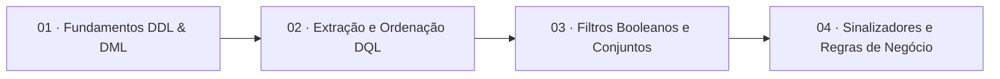

<p align="center">
  
</p>

<p align="center">Laboratório de criação de tabelas, consultas, filtros e indicadores em SQL.</p>

<p align="center">
  
  
  
</p>

<p align="center"><a href="#visão-geral">Visão geral</a> &nbsp;·&nbsp; <a href="#como-executar">Como executar</a></p>

---

## Visão geral

O **SQL Engineering Lab** documenta minha evolução prática na construção, modelagem e extração de dados relacionais utilizando **MySQL**. Mais do que comandos isolados, cada módulo simula cenários reais de sistemas corporativos e industriais — desde a definição rigorosa de tipos e tabelas até a criação de sinalizadores lógicos (*flags*) para relatórios de negócio.

## Principais módulos do laboratório

| Diretório | Escopo técnico |
|---|---|
| 01_fundamentos_ddl/ | Criação de bancos de dados, definição de schemas, tipagem (INT, VARCHAR, DECIMAL) e carga inicial de registros (INSERT). |
| 02_extracao_basica/ | Projeções estruturais (SELECT), renomeação de colunas e ordenação multicritério de relatórios (ORDER BY). |
| 03_filtros_logicos/ | Extração cirúrgica de dados combinando operadores relacionais, álgebra booleana (AND, OR, NOT) e conjuntos (IN, BETWEEN). |
| 04_simulacao_sinalizadores/ | Implementação de sinalizadores e indicadores de status diretamente nas consultas SQL para apoiar tomadas de decisão. |

<details>
<summary>Arquitetura de aprendizado</summary>



</details>

<details>
<summary>Estrutura do repositório</summary>

```text
SQL-engineering-lab/
├── assets/
│   └── project-animal.png          Emblema do projeto
├── 01_fundamentos_ddl/
│   └── Criação de bancos, tabelas e inserts.sql            Setup de schema e carga inicial
├── 02_extracao_basica/
│   └── Selects simples e ordenações.sql                    Consultas e ordenação de dados
├── 03_filtros_logicos/
│   └── Where, In, Between, lógicas booleanas.sql           Filtragem avançada e operadores
├── 04_simulacao_sinalizadores/
│   └── Sinalizadores.sql                                   Simulação de indicadores operacionais
└── README.md
```

</details>

## Como executar

1. Clone o repositório:
   ```bash
   git clone https://github.com/arthurlynow098/SQL-engineering-lab.git
   ```
2. Abra os scripts no **DBeaver** ou **MySQL Workbench** conectado a uma instância MySQL 8.0+.
3. Execute primeiro o script de 01_fundamentos_ddl/ para construir o ambiente antes de rodar as consultas analíticas das pastas seguintes.

---

<p align="center">
  <a href="https://github.com/arthurlynow098">GitHub</a> &nbsp;·&nbsp;
  <a href="https://arthurentsev.vercel.app/">Portfólio</a> &nbsp;·&nbsp;
  <a href="https://www.linkedin.com/in/entsevarthur/">LinkedIn</a>
</p>
